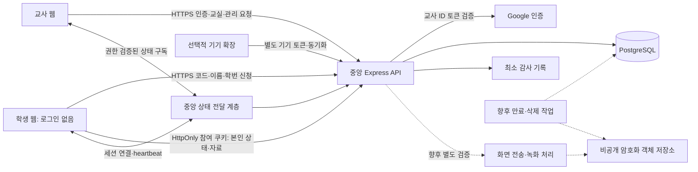
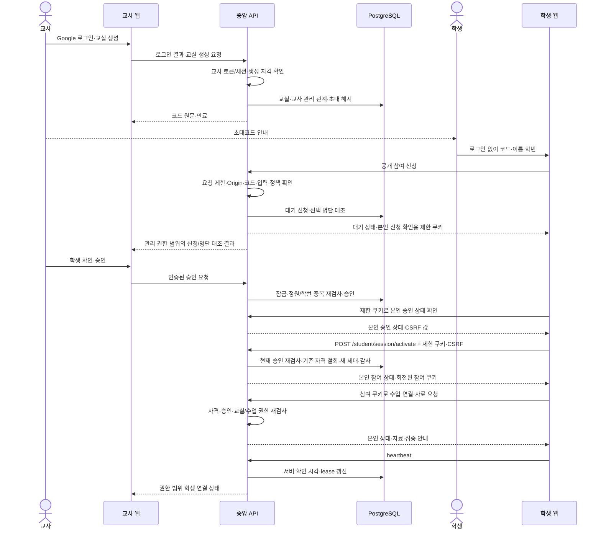

# CLARIO — 중앙 서버 기반 아키텍처

## 현재 MVP 실행 경계

`npm run mvp`는 기존 스택을 그대로 빌드한 뒤 `server/scripts/mvp.mjs`로
영속 로컬 PostgreSQL과 Express를 시작한다. 교사 `/teacher/`, 학생 `/student/`,
권한 API `/api`가 같은 원본이다. DB는 교사 브라우저와 독립된 중앙 저장소이며
다른 브라우저/프로필도 같은 API로 연결한다. 학교 API는 사용하지 않는다.
로컬 launcher는 자체 개발 DB만 마이그레이션하고 기존 운영 환경 변수나 DB를 변경하지 않는다.

- 인증: `password.ts`·`identity-access.ts`의 이메일 계정/해시 세션.
  교사 토큰은 메모리 전용이므로 새로고침 후 재로그인하고 DB 교실을 다시 조회한다.
  학생은 기존 `student-access.ts`·`student-sessions.ts`의 HttpOnly 쿠키·CSRF/승인 경계를 유지한다.
- 자료: 스키마 14의 `class_materials.audience`와 `classroom_material_recipients`
  `(material_id,class_id,participant_id)` 복합 FK로 교실 귀속/선택 대상을 보존한다.
  `classroom-materials.ts`에서 총 개수·페이지·수신·열기 모두 같은 대상 조건을 적용한다.
  선택 자료는 기존 기기 전달 대기열에 넣지 않고 기존 조직 자료 목록에서도 제외한다.
- 알림: `classroom-notifications.ts`가 현재 교실 관리자만
  `classroom_participation_audit`의 허용된 실제 처리/테스트 작업을 최근 50건 읽는다.
  테스트는 `notification.test.*` prefix로 저장하며 화면·입력 데이터는 저장하지 않는다.
  학생 API나 공용 알림 채널은 없다. 테스트 생성은 교실당 1분 10회로 제한한다.
- 교사 신청/학생/수업/자료/알림·집중 상태는 기존 5초 폴링을 재사용하고,
  학생 수업/자료/집중은 10초다. 승인/관리 확인 중 목록 자동 갱신은 멈춘다.
- 미디어·기기 제외: 현재 앱은 `SyntheticMedia`, `ScreenRecordingPanel`,
  `DocumentsPanel`, `SiteBlockingPanel`을 렌더링/로드하지 않는다.
  `DashboardRecordingPanel`은 교사 관리 화면에서 별도로 사용하며, 교사 동작으로 현재 브라우저 탭만
  캡처하고 오디오/학생 기기 화면은 수집하지 않는다. WebM은 브라우저 IndexedDB에만 보관된다.
  이 로컬 기능은 기존 학생 화면 캡처/녹화 API의 거부 경계를 변경하지 않는다.
  Google Drive/서버 저장·OAuth는 미구현이고 녹화 저장소 어댑터로 후속 분리한다.
  기존 Google 검증 어댑터는 호환용으로 남지만 MVP는 `allowGoogle=false`,
  launcher `googleClientId=''`로 외부 로그인 SDK/토큰 요청을 하지 않는다.

스키마 13은 독립 계정 비밀번호 해시·공유 인증 시도 예산을 추가한다.
스키마 14까지의 명시적 마이그레이션이 일반 서버 시작 조건이다.
운영 중앙 서버는 `DATABASE_URL`·`APP_ORIGINS`와 동일 원본 HTTPS 구성이 필요하며,
local launcher는 loopback 전용으로 실제 학교/기기 네트워크 배포를 대체하지 않는다.

## 1. 범위와 핵심 경계

목표 흐름은 **교사 Google 로그인 → 교실 생성·초대코드 → 학생 무로그인 코드·이름·학번 입력 → 중앙 서버 검증·교사 승인 → 학생 참여 자격·연결 → 교사 대시보드**다.

교사·학생의 컴퓨터는 클라이언트다. 별도로 운영하는 Express API와 PostgreSQL이 교사 신원·교실·학생 참여/자격·수업·연결 상태의 권위 있는 원본이다. 학생의 계정이 없어도 권한은 서버에서 검증한다. 교사의 로컬 설정/개발 서버는 실제 중앙 서버를 대신하지 않는다.

요구사항 ID·기능 범위는 [PRD.md](./PRD.md), 개발 규칙은 [AGENT.md](./AGENT.md), 구현 선행 관계는 [TASKS.md](./TASKS.md)를 따른다. 이 문서의 **목표** 모델/API/이벤트는 아직 구현 계약이 아니다.

## 2. 확인된 프로젝트와 현재 구현

```text
CLARIO/
├── apps/
│   ├── teacher/           # React + TypeScript + Vite
│   ├── student/           # React + TypeScript + Vite
│   ├── common/            # 인증/학급 UI, 합성 대시보드, UI 테스트
│   └── device-extension/  # 별도 Manifest V3 기기 클라이언트
├── packages/shared/      # 공통 TypeScript 타입·검증
├── server/
│   ├── src/              # Express, Google 검증, pg, 마이그레이션
│   ├── tests/            # API/임시 PostgreSQL/확장 대역 테스트
│   ├── scripts/          # 로컬 DB·설정 실행
│   └── setup/            # loopback 전용 설정 입력 UI
├── scripts/              # 배포 결과 검증
├── infra/                # 기존 Azure 인프라
├── .github/workflows/    # CI/CD
└── docs/                 # 기존 구현 계약·설치/운영 안내
```

- npm workspaces는 shared·teacher·student·server를 포함한다. 공통 UI와 확장은 기존 테스트/빌드 경로를 확인해 수정한다.
- 인증: Google ID 토큰 검증, nonce challenge, DB 해시 세션과 만료·로그아웃. 신규 `/api/identity`는 조직 사전 등록 없이 신원을 생성한다. 기존 조직 로그인·작업공간 가입은 별도 호환 경로다.
- 교사는 독립 Google 로그인, 학생은 무로그인 코드·이름·학번 신청/복구·본인 상태 복원/종료다. Google API를 호출하지 않는다. 교사는 관리 화면에서 신청/명단 대조·승인/거절을 수동 재확인한다. 기존 작업공간 로그인은 교사 앱의 별도 호환 경로다.
- 마이그레이션 1: 학교/사용자/학급/회원/인증/감사, 2: 등록 기기, 3: 기기 코드·토큰·heartbeat/자료/전달 기록, 4: 자율 집중 안내, 5: 작업공간 도메인 고유 제한 해제.
- 마이그레이션 6: 조직 없는 독립 신원, 교실 정원/참여 정책, 교실별 회원·초대·세션·세션 참여·연결 저장 구조와 기존 명부 backfill. 저장 기반이지 해당 운영 API 구현은 아니다.
- 버전 7은 무계정 학생 저장과 필수 승인을, 8은 서명 익명 브라우저 식별자용 공유 비밀·요청 제한 이벤트를 추가한다. 2단계 쿠키/CSRF·3단계 교실 관리에 이어 4단계 공개 신청·명단 대조/교사 승인·거절/복구 API/UI를 구현했다.
- 기기: 5분 유효 일회성 페어링 코드, 30일 기기 토큰, 서버 수신 기준 90초 lease, 확장 30초 동기화·교사 15초 조회 코드. 하드웨어 증명이나 실기기 검증 완료가 아니다.
- 자료는 기존 HTTPS 링크 저장과 발송 시점 기기 스냅샷을 보존하고 버전 9의 승인 학생 목록 수신/열기 요청 저장을 추가한다. 7일 접근 만료는 DB 자동 삭제를 뜻하지 않는다.
- 5단계 참여자 관리·6단계 수업/실제 연결·7단계 학생 웹 자료·8단계 자율 집중 안내를 구현했다. WebSocket/SSE는 채택하지 않았다. 실제 화면·운영 녹화/자동 삭제는 후속이고 합성 canvas 로컬 시험은 8절의 별도 경로다. 운영 TLS/동일 원본·확장 용량 검증은 별도다.
- 합성 대시보드는 서버와 연결되지 않는 미리보기다. 실제 인증 화면과 별도다.
- 버전 12는 `classroom_documents`·`classes.blocked_domains`·`classroom_browser_connections`와 파일 대상 ID 감사를 추가한다. PDF 바이너리는 선택형 비공개 서버 디스크에만 저장하고 DB에는 상태/크기/교실/행위자를 둔다. 실제 미디어 엔진의 비활성 경계를 변경하지 않는다.

현재 구현 상세는 [인증 안내](./docs/phase-2-authentication.md), [기기 계약](./docs/device-client.md), [Chromebook 조사](./docs/chromebook-phase-0.md), [Azure 시험 배포](./docs/azure-deployment.md)를 참고한다. 이 자료의 기존 기본 흐름은 새 교실 참여 흐름 구현 후 함께 갱신해야 한다.

## 3. 목표 구성과 책임



상태 전달 계층은 논리적 책임이다. 새 서버/브로커 도입이 확정된 것은 아니다.

| 구성 | 책임 |
|---|---|
| 교사 웹 | Google 인증, 교실 생성·초대·명단 대조·승인/퇴장/복구·수업·검색/정렬·자료·집중 안내 |
| 학생 웹 | 무로그인 코드·이름·학번 신청, 대기/거절·본인 상태, 자격 기반 재접속·복구 신청, 참여 종료·자료/안내 |
| 중앙 API | 교사 인증·교실 권한, 코드/정보 검증·승인·정원/중복 제어, 학생 자격 발급/철회·상태/자료·감사 |
| DB | 교사 계정·교실·선택 명단·학생 참여자/신청/자격 해시·수업/연결, 교실 범위 무결성 |
| 상태 전달 | 교사 세션/학생 자격을 검사한 채널, heartbeat·lease·다중 연결, 재연결·권한 철회 |
| 기기 확장 | 등록 기기의 별도 인증·상태·지원 기능. 학생 웹 참여의 필수 구성 아님 |
| 향후 미디어/저장·삭제 | 지원·정책 검증 후 화면·녹화, 객체 접근/만료·삭제와 증거 |

Google OAuth 클라이언트 설정은 서비스 운영자의 책임이다. 교사가 각자 OAuth 클라이언트를 만들거나 비밀번호를 제공하지 않으며 학생은 Google 인증을 하지 않는다. 교사의 학교 관리 계정 외부 앱 제한은 별도 안내한다.

## 4. 목표 데이터 모델과 기존 스키마 전환

| 개념 | 현재 | 목표 및 핵심 제약 |
|---|---|---|
| 교사 신원 | `users`, Google sub/고유 이메일, 기존 조직 역할/독립 member | 교사 Google 신원과 교실별 관리 관계. 학생 더미 계정/가짜 이메일 금지 |
| 조직/작업공간 | `schools`, 도메인은 더 이상 고유하지 않음 | 정책 경계로 재사용; 학교 소속 검증과 구분. 일반 코드 참여의 사전 관리자 등록 조건 제거 |
| 교실 | `classes`, 정원·교사 승인 필수 CHECK·도메인·종료 필드 | 교사 관리 범위·정원 40/최대 100. 학생 도메인 제한 미사용 |
| 관리 관계 | 계정 기반 `classroom_memberships`, 기존 명부 | 교사의 교실 관리 관계 보존. 학생 무계정 참여와 분리 |
| 학생 참여자 | `classroom_participants`·승인/복구·참여자 관리 API/UI | 교실별 이름/학번·승인/퇴장/차단·자격 세대. 전역 계정 불필요, 현재 연결과 구분 |
| 선택 학급 명단 | `classroom_roster_entries`·교사 범위 CRUD API/UI | 교사 전용 명단 대조를 승인 목록에 연결. 일치만으로 승인 금지 |
| 참여/복구 신청 | `classroom_join_requests`·신청/승인/거절/복구 API/UI | 최초/복구 구분·기본 pending·결과/승인자·교실 귀속 |
| 학생 참여 자격 | 저장 제약·내부 발급 함수·학생 쿠키 API/UI | 공개 신청/승인·복구와 범위 제한 해시·기간/회전/철회·현재 승인 검사 연결 |
| 교실 초대 | 버전 6 테이블·3단계 관리 API/UI | 교실·코드 해시·발급자·만료·폐기. 교실당 활성 하나·원자적 교체 |
| 수업 세션 | 버전 6 저장 기반 | 교실·시작/종료·종료자, 교실당 활성 하나 |
| 수업 참여·연결 | 버전 7 출석/연결·수업 API와 DB lease·순서/다중 탭 집계 | 교사 5초/학생 10초 HTTPS 폴링, 기존 계정·기기와 분리 |
| 교실 자료 | `class_materials`, `material_deliveries`, 버전 9 `classroom_material_receipts` | 현재 승인 참여자의 목록/수신·열기 요청 API/UI. 기기 전달과 학생 웹 수신 구분 |
| 집중 안내 | `classes.voluntary_focus`, `focus_version`, `focus_updated_at` | 8단계 API/UI, 기본 꺼짐, 활성 세션·버전·마지막 확인 포함, 종료 시 해제 |
| 기기 | `registered_devices`, `device_pairings` | 별도 자격 증명 유지. 웹 회원·학생 신원·물리 기기 신원·지원 능력 분리 |
| 감사 | `audit_logs` | 행위자·범위·결과·시각, 초대/승인·퇴장·세션·정책·삭제 추가. 원문 코드·영상·토큰 금지 |
| 녹화·보관·삭제 | 없음 | 후속: 정책 버전/상한·녹화 대상/학생별 구간·객체/복제본·만료·삭제 작업/오류·접근 감사 |

표는 실제 저장 기반과 후속 API/운영 동작을 구분한다. 테이블이 존재한다고 교실 참여·화면 연결·보관/삭제까지 작동하는 것은 아니다.

### 버전 7의 무계정 학생 저장 계약

- `guest-schema.ts`는 기존 테이블/계정/기기/자료·인증 세션을 삭제하거나 학생을 자동 이전하지 않는다. 기존 이름/이메일에서 학번을 추정하지 않는다.
- `classes.approval_required`는 기존/신규 모두 true이며 false를 CHECK로 거부한다. 정원은 기존 명부 인원을 보존하도록 늘리고 100명 초과는 전체 전환을 실패시킨다. 기존 조직 경로의 학생 수도 새 참여자와 함께 정원에 포함한다.
- `classroom_roster_entries`는 교실별 이름/학번만 저장하며 `(class_id,student_number)` 고유다. `classroom_participants`는 동일 고유 키·상태·필수 승인자/시각·자격 세대를 갖는다. 퇴장/차단 후에도 같은 학번 신규 행을 허용하지 않고 기존 행 복구로 처리한다.
- 이름은 NFC·trim 후 1~100 Unicode 코드 포인트, 학번은 trim 후 ASCII 숫자 1~20자리 문자열이다. 공통 정규화 함수와 DB CHECK가 일치하며 선행 0과 다른 교실의 같은 번호를 보존한다.
- `classroom_join_requests`는 최초/복구·신청 정보·초대/교실 FK·기본 pending·만료·처리 결과/행위자를 갖는다. 복구 대상도 같은 교실의 참여자 FK다. 명단 입력/복구 신청만으로 기존 참여자나 자격을 변경하는 trigger는 없다.
- `student_participation_sessions`는 SHA-256 해시 형식·교실 귀속·pending(신청 FK)/participant(참여자 FK와 세대) 중 하나다. pending 최대 30분, participant 절대 12시간/유휴 2시간 상한을 저장 제약으로 보장한다. 주체/발급 시각 변경·절대 만료 연장·철회 취소를 막고 회전은 새 행으로 처리한다.
- `classroom_participant_attendance`는 기존 `classroom_sessions`와 무계정 참여자를 복합 FK로 묶는다. `classroom_participant_connections`는 실제 출석·교실·참여자 귀속과 자격/연결 세대·서버 last-seen/lease를 저장한다. 기존 계정 연결 테이블과 혼용하지 않는다.
- `classroom_participation_audit`는 교사/참여자/신청 행위자 중 하나를 저장한다. 기존 `audit_logs.actor_id`의 사용자 FK에 더미 학생을 넣지 않는다. 코드 검증 이전의 무효 요청은 기존 비밀 없는 거부 로그를 사용하고, 이 새 테이블은 저장된 교실/신청 이후 감사용이다.
- 참여자 승인과 기존 명부 추가는 교실 행 잠금·정원 trigger로 직렬화하며 정원 축소도 검사한다. 실제 교사 권한·신청 만료·현재 승인/세대·실시간 철회는 후속 서버 API가 검사해야 한다.
- 마이그레이션은 트랜잭션 안에서 재실행 가능하며 충돌/제약 실패는 버전·기존 정책까지 rollback한다. 현재는 운영 전 백업 후 `db:migrate`로 버전 10까지 적용해야 한다. 자동 다운 마이그레이션은 없다.

### 버전 6의 실제 물리 모델과 새 목표의 차이

- `users`의 UUID·Google sub·이메일·기존 세션을 유지한다. 신규 `member`는 `school_id=NULL`; 기존 `teacher/student/school_admin`은 조직이 필수다. 응답 신원에는 전역 역할/조직을 노출하지 않는다.
- `classes`는 버전 6에서 개인 교실을 위해 조직을 선택값으로 바꾸고 정원·참여 정책·도메인·종료 시각을 추가했다. 버전 7은 교사 승인을 필수로 바꿨다. 3단계 생성 API는 `school_id=NULL` 교실·직접 승인 관리자 관계·초대코드를 한 트랜잭션으로 만든다.
- `classroom_memberships`는 `(class_id,user_id)` 고유, `manager/student` 역할과 pending/approved/rejected/left/removed/blocked/cancelled 상태를 저장한다. 이 구조는 계정 기반이며 새 무계정 학생은 별도 참여 모델과 명시적 교사 승인이 필요하다.
- `classroom_invitations`는 해시·발급자·만료·폐기와 교실당 미폐기 코드 하나를 저장한다. 만료 코드도 교체 트랜잭션에서 폐기해야 한다.
- `classroom_sessions`는 교실당 활성 세션 하나, `classroom_session_members`는 회원과 별도의 세션 참여, `classroom_connections`는 이에 귀속된 연결 세대·서버 확인/lease/종료 시각을 저장한다. heartbeat API는 아직 없다.
- 기존 교사/학생 명부는 출처를 표시해 approved로 이전한다. 기존 명부 변경 trigger를 유지하고 조회 시 현재 조직 역할·담당 교사·기존 회원도 재검사한다. 조직 관리자는 기존 자기 조직 교실만 조회한다. 새 직접 회원은 사용자 소속 이동/복제 없이 다른 조직 교실에도 참여할 수 있다.
- 버전 5→6 전환·재실행·권한 비확대·실패 rollback을 임시 실제 PostgreSQL로 시험한다. 기존 정원 40 초과는 실제 인원으로 늘리되 100 초과는 명시적으로 전체 전환을 실패시킨다. 운영 전 백업과 정원 조정이 필요하다. 자동 down migration은 제공하지 않으며 전진 수정 또는 검증된 백업 복구를 사용한다.
- `migrate(pool, targetVersion)`은 테스트에서 이전 버전 DB를 만드는 전진 실행 선택값이며 다운 마이그레이션이 아니다. 현재 운영 준비에는 관리 명령으로 버전 10까지 적용한다.

### 구현된 독립 인증 API

공통 `/api/auth/config`, `/api/auth/challenge`와 기존 프로덕션 Google 검증기를 재사용한다.

| API | 동작 |
|---|---|
| `POST /api/identity/auth/google` | `credential`, `challengeId`, 1~100자 `displayName`. 검증된 sub로 신원 생성/로그인, 최초 이름 저장, 기존 이름 유지. 해시 저장한 1시간 세션 반환 |
| `GET /api/identity/me` | 활성 신원과 `canCreateClassroom: true`. 생성 가능 자격이지 기존 교실 권한 아님 |
| `GET /api/identity/classrooms` | 현재 승인 관계/기존 관리 범위의 미보관·미종료 교실과 해당 역할만 반환. 학생 명부는 반환하지 않음 |
| `POST /api/identity/logout` | 현재 세션 철회·감사, 204 |

동일 sub 최초 로그인 경합은 잠금으로 직렬화한다. 다른 sub의 같은 이메일은 409, sub 미연결 기존 이메일은 `LEGACY_LINK_REQUIRED`로 기존 검증 로그인 경로를 안내한다. 이메일만으로 기존 권한을 결합하지 않는다. 독립 신원은 기존 조직 API에서 `LEGACY_WORKSPACE_REQUIRED`로 차단한다.

이 계정 UI의 토큰은 메모리에만 보관하고 새로고침 시 재로그인한다. 401/만료 시 비공개 데이터를 지우며 로그아웃 실패는 성공 처리하지 않는다. 이는 교사 인증에 재사용할 동작이지 학생 재접속 방식이 아니다. 현재 일반 API 한도인 프로세스/IP당 분당 600회는 새 학생 참여 전용 브라우저/IP/코드 제한을 대체하지 않는다.

위 API는 교사/기존 계정 기반 구현이며 새 학생의 참여 API가 아니다. 학생 기본 화면에서는 제거했으며 학생은 이 API로 계정을 만들지 않는다.

새 확정 정책은 교사 Google 인증·자기 교실 생성, **교사 승인 필수 + 선택 명단 대조**, 정원 기본 40/최대 100, `ABCDEFGHJKLMNPQRSTUVWXYZ23456789`의 12자리 코드(60비트)/24시간, 참여 시도 15분당 브라우저 10/IP 100회다. 교실/코드 발급·명단 관리는 구현했지만 실제 학생 참여·승인·참여 요청 제한은 후속이다.

### 3단계 교사 교실 관리 API

공통 접두사는 `/api/identity/classrooms`이며 교사 bearer 인증을 사용한다. 생성 이외의 모든 경로는 교실 잠금 후 현재 세션·계정 활성·관리 역할을 재검사한다. 기존 조직 관리자·담당 교사·직접 관리자와 목록 조회는 같은 범위 판정을 재사용한다. 학생 쿠키·초대코드·요청의 역할/소유자 ID로 관리 권한을 얻지 못한다.

| 메서드/경로 | 처리 |
|---|---|
| `POST /` | 이름·정원(기본 40/1~100)으로 개인 교실·관리 관계·초기 코드·감사를 원자 저장, 201 |
| `GET /:id` | 관리 교실 설정·코드 메타데이터·선택 명단. 원문 코드/해시 반환 금지 |
| `PATCH /:id` | 이름·정원만 변경. 현재 승인 참여자+기존 명부보다 정원 축소 금지. 자동 승인/소유자 변경 필드 거부 |
| `POST /:id/invitations` | 기존 미폐기 코드를 폐기하고 새 12자 난수·24시간 코드 발급, 201 |
| `DELETE /:id/invitations` | 현재 코드 폐기. 접수된 대기/기존 승인 학생은 유지 |
| `GET /:id/roster` | 교사 범위 선택 명단 조회 |
| `POST /:id/roster` | 이름 NFC/trim·학번 문자열 정규화, 교실별 학번 중복 거부, 201 |
| `PATCH /:id/roster/:entryId`, `DELETE /:id/roster/:entryId` | 교실 귀속 항목만 수정/삭제. 실제 참여자·자격은 변경하지 않음 |
| `POST /:id/close`, `POST /:id/archive` | 종료/보관·코드 폐기·대기 취소·학생 자격 철회·연결/출석·활성 세션 종료·집중 해제·기기 토큰/페어링 철회·감사 원자 처리 |

- 기본 목록은 미종료·미보관만 반환한다. `GET /api/identity/classrooms?includeInactive=true`는 **관리 교실에만** 종료/보관 기록을 추가하며 교사 UI가 이를 사용한다. 학생 역할의 닫힌 교실이 노출되지 않는다.
- 충돌은 DB 코드 해시 고유 제약으로 판정하고 제한 횟수 내 난수를 다시 만든다. 반복 실패나 감사 실패는 전체 트랜잭션을 rollback하며 이전 코드까지 임의 폐기하지 않는다. 만료 코드도 교체할 때 미폐기 고유 슬롯을 비운다.
- 교실 종료와 코드 교체는 같은 교실 잠금으로 직렬화한다. 종료/보관 후 설정·코드·명단 변경은 409이고 권한 있는 관리 조회/반복 종료는 허용한다. 현재 다시 열기 기능은 없으며 보관은 개인정보 삭제가 아니다.
- 기존 `/api/classes/:id` 보관도 같은 종료 정리를 재사용하되 기존 기기 명부 삭제 동작은 보존한다. 기존 명부·기기 접근 경로도 `closed_at`을 검사한다.
- 발급 원문은 UI 메모리에서만 보이고 다른 작업/재확인·숨기기·만료·로그아웃 시 제거한다. 교사 토큰도 메모리이므로 새로고침 후 재로그인하며 코드 원문은 재조회하지 못한다. 명단·설정은 서버에 남는다.
- 실제 교사 Google OAuth·운영 DB 적용/배포는 별도 검증이다. 코드 생성이나 참여 승인 성공을 온라인/수업 연결 성공으로 표시하지 않는다.

### 4단계 신청·승인·복구 및 공유 제한

| 경로 | 권한·결과 |
|---|---|
| `POST /api/student/join` | 같은 원본·JSON, `{code,name,studentNumber,kind:"join"|"recovery"}`만 허용. 유효 코드/교실·입력·대기 한도 검사 후 제한 쿠키와 본인 신청 상태, 201 |
| `GET /api/identity/classrooms/:id/requests` | 현재 관리자. 유효 시간 내 최근 최대 200건·이름/학번·신청 종류/상태·교사 전용 명단 대조/기존 참여 상태, 200 |
| `POST /api/identity/classrooms/:id/requests/:requestId/approve` | 현재 관리자·교실 잠금·최신 정원/중복/유효 제한 자격 재검사. 복구는 `{confirmRecovery:true}` 필수, 200 |
| `POST /api/identity/classrooms/:id/requests/:requestId/reject` | 현재 관리자·미처리/유효 신청만 거절, 본인 제한 쿠키로 거절 확인, 200 |

- 학생 응답에는 다른 학생 존재·명단 대조·신청/참여자 ID를 넣지 않는다. 존재하지 않는 번호의 복구 요청도 동일한 대기 응답이며 최초 신청으로 처리한다. 기존 학생에 대한 일반 신청을 교사가 승인하려 하면 명시적 복구 필요 오류를 반환한다. 자진 퇴장은 재신청, 퇴장/차단은 복구 확인 후에만 재승인한다.
- 교사 승인 시 참여자 승인/정원 확보·기존 자격/연결 철회·세대 증가·과거 미활성 승인 신청 취소·감사를 원자 처리한다. 새 원문 자격은 교사에게 반환하지 않는다. 학생의 기존 제한 쿠키·CSRF `/session/activate`가 현재 승인 교사의 관리 권한까지 확인하고 새 자격을 전달한다. 복구 신청만으로 이전 기기를 끊지 않는다.
- 같은 학번의 여러 미확인 신청은 본인 여부를 구분할 수 없어 자동 통합/승인하지 않는다. 교사가 신청별로 확인하며 수량·속도 한도로 제한한다. 학생이 승인 후 활성화 전에 종료하면 해당 승인 관계를 퇴장 상태로 바꾸고 대기 자격을 철회한다. 이미 대체된 과거 신청은 새 참여를 종료할 수 없다.
- 신청/승인과 5단계 참여 학생 관리 목록은 수동 재확인이다. 6단계 수업 현황은 별도 교사 5초·학생 10초 자동 폴링이다.
- 버전 8의 `student_join_rate_secret`에 DB별 난수 공유 비밀, `student_join_rate_events`에 HMAC 식별자·서버 시각만 저장한다. 원문 IP·코드·익명 브라우저 값은 저장/로그하지 않는다. 익명 브라우저 쿠키는 서명 난수·HttpOnly·Strict, HTTPS에서 `__Host-clario-browser`·Secure·host-only이며 로컬 HTTP에서만 별도 이름이다. 참여 종료 후에도 현재 브라우저의 요청 한도는 유지한다.
- 최근 15분 브라우저 10/IP 100/코드 100회, 교실별 유효 대기 100건/30분이다. 정렬한 HMAC 키에 PostgreSQL 트랜잭션 잠금을 걸고 공유 이벤트를 집계한다. 허용된 시도는 입력/코드 오류나 후속 저장 rollback과 무관하게 카운트되며 한도 초과는 `Retry-After`+429다. 제한된 재시도는 이벤트를 무한 추가하지 않는다. 15분 초과 이벤트는 다음 신청에서 삭제한다. 무요청 기간의 정기 물리 삭제는 운영 작업으로 별도 구성해야 한다.
- 브라우저 쿠키 초기화는 브라우저 한도를 우회할 수 있어 IP/코드를 함께 제한한다. 현재 `trust proxy`를 켜지 않고 소켓 IP만 사용한다. 신뢰할 프록시 홉/주소와 공유 학교 IP 용량은 운영 전 검증한다. 임의 전달 헤더를 신뢰해 우회하지 않으며 프록시 뒤에서 여러 사용자가 하나의 IP 한도를 공유할 수 있음을 명시한다.

### 5단계 참여 학생 관리 (REQ-002, 005~006, 008)

접두사는 `/api/identity/classrooms/:id/participants`다. 기존 버전 7 저장과 공통 `manager`·교실 잠금·`disconnectStudent`를 재사용하며 DB 버전은 8 그대로다.

| 경로 | 권한·결과 |
|---|---|
| `GET /` | 현재 관리자, 종료/보관도 읽기 허용. `{participants,total,page,pageSize:50}`. 이름/학번·참여 상태·승인/변경 시각·명단 대조·자격 세대·`connectionState:"unavailable"`만 반환. 실제 연결 시각/온라인을 만들지 않는다. 조회 감사 |
| `POST /:participantId/remove` | 현재 관리자·열린 교실·해당 교실 참여자. `{confirm:true,expectedGeneration:number}` 필수. 상태/세대 변경·기존 신청/자격/연결 철회와 감사 후 `{participant}`, 200 |
| `POST /:participantId/block` | 같은 검사/원자 처리, 상태 `blocked`. 차단을 퇴장으로 낮추는 요청은 409. 동일 상태/현재 세대 재요청은 중복 감사 없이 멱등 |

- 조회 조건은 `search`(NFC/trim 100 코드 포인트, 대소문자 무시 이름/문자열 학번 부분 일치, `%`/`_`도 리터럴), `status=all|approved|left|removed|blocked`, `sort=studentNumber|name|status|approvedAt`, `direction=asc|desc`, 1부터 6자리까지 정수 `page`다. 기본 학번 오름차순·1페이지, 동일 키는 ID로 안정 정렬한다. 학번은 숫자 변환 없이 문자열 순서다. 알 수 없는/반복 조건을 거부하며 학생 자격·타 교실/참여자 ID는 관리 권한이 아니다.
- 변경 시 최신 자격 세대가 다르면 409 후 재확인한다. 승인/복구/활성화/종료와 같은 교실 잠금으로 직렬화한다. 동일 교실/학번의 pending/approved 신청을 취소하고 그 제한 자격 및 참여 자격을 철회한다. 자격 세대를 올리고 연결/출석을 종료한 뒤 교실 참여 감사와 대상 ID를 가진 `audit_logs`를 함께 저장한다. 감사 실패 시 모두 rollback한다.
- 과거 미활성 승인/복구 대기는 퇴장/차단을 되돌릴 수 없다. 이후 **새 복구 요청**에 교사가 본인 확인 후 명시적 승인해야 한다. 일반 중복 신청은 이를 우회하지 못하며 다른 학번으로 신청한 동일인을 완전히 판별하는 기능은 아니다.
- 실제 참여 목록과 선택 명단/신청 목록은 별도 UI다. 승인/관리 변경은 상대 목록을 무효화하고 다시 확인하게 한다. 신청 목록의 검색/정렬은 서버가 확인한 최대 200건 범위다. 권한 오류 시 개인정보/확인을 지우고 교실 전환/늦은 응답을 무시한다. 네트워크 오류는 마지막 확인 결과라고 표시하며 오래된 정보로 변경하지 못하게 한다. 저장 후 재조회 실패도 구분한다.

### 전환 원칙 (REQ-001~007, REQ-014)

1. 버전 1~7과 기존 데이터를 보존하고 후속 버전으로 전환한다. 로컬 임시 DB 시험을 운영 DB 적용 증거로 간주하지 않는다.
2. 버전 6의 `classroom_memberships.user_id`·수업 참여/연결 FK는 무계정 학생을 표현하지 못한다. 새 참여자/신청/명단/자격 저장 관계와 교실 귀속 FK를 추가한다. 더미 계정·가짜 이메일이나 단순 제약 해제로 우회하지 않는다.
3. 기존 교사·학생·관리자·기기/자료·명부·세션 데이터를 보존한다. 기존 Google 학생을 이름/학번만으로 새 참여자와 자동 연결하지 않는다. 명시적 교사 확인 이전 절차를 별도 설계하고 기존 관리자 범위를 확장하지 않는다.
4. 교실 생성은 해당 교실의 교사 관리 관계만 만든다. 무계정 학생은 교실 범위 참여자이며 전역 사용자/조직 관리자 역할을 받지 않는다.
5. 새 교실은 교사 승인 필수다. 이전 `approval_required=false` 데이터/기본값과 정책 상수 전환·구버전 경로 차단/호환을 새 버전에서 함께 처리한다. 기존 자료/기기·감사 행위자·backfill·실패 rollback/백업 복구도 검증한다.
6. 교사 Google 신원의 기준은 검증된 sub다. 학생 이름·학번은 교실 내 대조 값이지 전역 인증 정보가 아니다. 교사 계정과 학생 참여 자격을 별도 인증 경계로 유지한다.

## 5. 인증부터 참여·연결까지



### 인증 경계

- 교사 API는 기존 Google 검증·nonce 단일 사용·해시 bearer 세션을 재사용한다. 학생 공개 신청은 Google 인증 미들웨어 밖에 두되 Origin/입력/요청 제한을 적용한다.
- 학생의 본인 상태/수업 API는 서버 발급 참여 쿠키를 검사한다. 요청의 `participantId`/`classId`/학번/역할을 자격으로 믿지 않는다. 대기 자격은 본인 신청 상태 확인만 허용한다.
- 학생 자격은 교실/참여자 범위 난수 해시·유휴/절대 만료·철회/회전으로 관리한다. 대기에서 승인으로 바뀌면 쿠키를 회전하고 승인 전 자격으로 보호 리소스를 호출할 수 없게 한다. 승인 상태 재검사도 매번 수행한다.
- 상태 변경 요청은 HttpOnly·Secure만으로 보호되지 않는다. SameSite·Origin·CSRF를 검사하고 URL/로그/JS 영구 저장소에 자격을 싣지 않는다. 기존 교사 HTTP 유틸리티의 `credentials: omit`를 학생 경로에 그대로 적용하지 않는다.
- 학생은 상대 경로 `/api/student`·`credentials: same-origin`만 사용한다. `VITE_API_BASE_URL`로 교차 원본 학생 API를 지정하지 않는다. 현재 Azure 정적 웹/API는 분리 사이트이므로 운영 같은 원본 프록시를 구성·검증하기 전 새 학생 참여를 운영 가능하다고 하지 않는다. SameSite를 완화하거나 Google 로그인을 fallback으로 사용하지 않는다.
- 학생 응답에는 본인의 신청/참여·자료·상태만 포함한다. 명단 조회나 다른 학생 존재 여부를 드러내는 중복 오류는 반환하지 않는다. 교사는 현재 관리 교실의 승인/대기 목록만 본다.

### 안전한 재접속·복구

- 새로고침/통신 복구는 유효 참여 쿠키와 서버 승인/교실/수업 상태 재검사로 처리한다. 동일 참여자를 재사용하며 새 수업 참여·연결과 구분한다.
- 자격 분실/새 기기/만료는 코드·이름·학번으로 **복구 신청**만 할 수 있다. 본인 확인은 교사가 수행하며 기존 참여자를 자동 인수할 수 없다.
- 복구 승인 전에는 기존 자격/연결을 유지한다. 승인 후 원자적으로 새 자격 세대 발급·이전 자격 철회·이전 연결 종료·감사를 수행한다. 학생이 새 브라우저에서 제한 쿠키로 승인 결과를 받아야 한다.
- 자진 퇴장/참여 종료는 자격·연결 철회와 쿠키 제거를 처리한다. 교사 퇴장/차단은 명시적 교사 복구가 필요하다. 공유 기기의 다음 사용자를 이전 학생으로 신뢰하지 않도록 종료 UI를 제공한다.
- 자격 기간은 승인 전 최대 30분, 승인 후 유휴 2시간/절대 12시간이다. 승인/복구 시 회전하고 갱신으로 절대 만료를 늘리지 않는다. 브라우저당 한 교실이며 전환 전 종료한다. 복구 신청/교사 확인 UX는 4단계다. 이름/학번만으로 동일인을 증명하거나 다른 학번 재신청까지 완전 차단한다고 보장하지 않는다.

### 2단계 학생 자격 런타임 계약

| 경로 | 자격과 처리 |
|---|---|
| `GET /api/student/session` | 쿠키 없으면 `state:none, joinAvailable:true`와 익명 브라우저 쿠키를 제공한다. 있으면 본인 신청 또는 참여만 반환. 승인 참여의 유휴 기간만 절대 만료 이내에서 갱신. 웹 presence 갱신 아님 |
| `POST /api/student/session/activate` | 유효한 제한 쿠키·CSRF로 **이미 승인된 신청만** 활성화. 교실 잠금 후 재검사·기존 자격 철회·참여 세대 회전·기존 연결 종료·감사. 교사 승인 자체를 수행하지 않음 |
| `POST /api/student/session/end` | 쿠키·CSRF로 자격 철회, 대기는 취소, 승인 참여는 퇴장/연결·출석 종료·감사 후 쿠키 제거. 감사 실패 시 전체 rollback. 이미 철회된 자격의 반복 종료는 멱등 처리 |

- 자격은 32바이트 난수이며 DB에는 SHA-256 해시만 저장한다. 자격 원문은 JSON에 반환하지 않는다. JS 메모리의 CSRF 값은 자격으로 사용할 수 없다.
- 운영 쿠키는 `__Host-clario-student; Path=/; HttpOnly; Secure; SameSite=Strict`, Domain 없음. 비운영 localhost/127.0.0.1 HTTP에서만 `clario-student-dev`를 쓴다.
- 허용된 정확한 Origin과 실제 Host가 같아야 한다. Origin 없는 GET은 `Sec-Fetch-Site: same-origin`만 허용한다. 변경 요청은 Origin·JSON을, 기존 참여 쿠키가 있으면 자격 기반 CSRF도 요구한다. 익명 최초 신청은 정확한 Origin·JSON·Strict 쿠키 경계와 요청 제한으로 보호한다. 임의 forwarded 헤더로 Host/TLS를 추론하지 않는다.
- 교실 단위 잠금을 먼저 얻고 현재 자격/신청/참여를 재검사한다. 대기 자격은 참여/관리 권한이 없고, 차단·퇴장·만료·세대 불일치·종료/보관 교실의 자격은 거부한다. 후속 승인/복구/종료 서비스도 같은 잠금 순서를 따라야 한다.
- 중복 활성화는 새 자격을 한 번만 발급한다. 실패한 경쟁 활성화 응답은 성공한 새 쿠키를 지우지 않는다. 새로고침 복원·수동 재확인과 로컬 만료 시 개인정보 제거를 제공하며 서버 오류를 빈 목록/참여 성공으로 바꾸지 않는다.
- 내부 발급 함수는 신뢰된 트랜잭션에서만 호출한다. 4단계의 공개 신청은 검증 후 최초 제한 쿠키를 발급하고 학생은 이 쿠키로 승인 후 활성화한다. 교사 승인 없이 참여 자격을 발급하는 경로는 없다. 테스트의 합성 인증은 운영 우회 경로가 아니다.

### 코드와 회원 트랜잭션

- 암호학적 난수 생성·해시 저장·전역 활성 충돌 검사, 교실당 활성 하나를 보장한다. 원문은 발급 시만 반환한다.
- 재발급은 같은 트랜잭션에서 이전 코드 폐기와 새 코드 저장을 수행한다. 원문 재조회는 제공하지 않는다.
- 참여 신청은 요청 제한/Origin → 코드 만료/폐기·교실 상태 → 이름/학번·차단·선택 명단 → 대기 저장/제한 자격 순으로 처리한다. 학생 도메인/Google 검사는 없다. 명단 일치여도 교사 승인이 필수다.
- 교실 잠금 또는 동등한 동시성 제어와 교실별 정규화 학번의 승인 고유 제약으로 중복·정원 경합을 막는다. 학번은 선행 0을 보존하는 문자열이고 타 교실의 같은 번호와 별개다. 대기는 정원 점유가 아니지만 수량/만료 제한을 적용한다.
- 코드 접수 시 유효하면 대기를 저장할 수 있다. 이후 코드 만료/교체만으로 대기를 삭제하지 않으며 승인 시 최신 정책·참여 상태·정원/중복을 다시 검사한다.
- 코드·재발급·교실 종료·승인 경합을 직렬화한다. 종료된 교실에 늦게 승인/연결이 생기지 않아야 한다.
- 코드 폐기는 신규 신청을 막지만 유효 승인 관계/참여 자격을 즉시 없애지 않는다. 복구는 위의 자격/교사 확인 계약을 따른다.
- 참여 제한은 최근 15분 브라우저 10/IP 100/코드 100회·대기 100건/30분이며 버전 8 PostgreSQL로 공유한다. 서버 발급 익명 브라우저 ID는 초기화 우회가 가능하므로 단독 방어가 아니다. 운영 신뢰 프록시와 공유 학교 IP 오차는 배포 전 검증한다.
- 오류와 감사에 원문 코드·자격·타 학생 정보를 넣지 않는다. 인증 전 요청은 요청 식별자로, 승인/참여 행위는 교사 ID 또는 교실 범위 참여자 ID로 구분해 감사한다.
- 기존 `audit_logs.actor_id`의 사용자 FK를 학생에게 그대로 요구하지 않는다. 새 감사 행위자 모델은 교사/학생 참여자/인증 전 요청을 구분하고 교실 귀속을 검증하며 더미 사용자로 우회하지 않는다.

## 6. 세션·연결 상태와 실시간 통신 (REQ-007~008)

### 교실과 수업의 수명

- 교실 생성 시 코드로 최초 회원을 받을 수 있다. 활성 수업이 없으면 가입 상태만 표시하고 수업 접속 중이라고 표시하지 않는다.
- 세션 시작 시 승인된 학생은 유효 참여 자격을 재검사한 후 코드 없이 연결한다. 승인 관계만 있고 자격이 없으면 교사 확인 복구가 필요하다.
- 세션 종료 트랜잭션은 세션 비활성·집중 해제·초대 폐기·대기 신청 취소를 반영한다. 이후 종료 이벤트/재조회로 연결을 닫는다.
- 회원 관계는 유지한다. 다음 세션의 기존 회원 재접속과 신규 참여용 코드 발급을 분리한다.
- 교실 종료/보관은 신규 참여·관리 외 실시간/자료 접근을 중단한다. 삭제와는 별도다.
- 교사 계정/학생 참여 권한 철회·수업 종료는 관련 연결·향후 미디어에 반영한다. 기기는 별도 자격과 귀속을 확인해 처리한다.

### 상태 판정

| 상태 | 근거 |
|---|---|
| 연결 중 | 인증·회원/세션 확인 후 최초 상태 동기화 중 |
| 온라인 | 활성 세션·회원이며 하나 이상의 연결 lease가 신선함 |
| 재연결 중 | 확인된 연결이 heartbeat 신선도 경계를 지났으나 유예 안이거나 복구 시도 중 |
| 오프라인 | 유예 만료 후 유효 연결 없음. 마지막 서버 확인 시각 표시 |
| 서버 상태 확인 불가 | 클라이언트가 중앙 서버의 최신 상태를 확인하지 못함. 학생 전원 오프라인과 다름 |

- 클라이언트 타임스탬프가 아니라 서버 수신 시각을 사용한다. 승인·유효 참여 자격·수업 참여·온라인은 별개다. 대기 학생을 수업 온라인 학생 수로 집계하지 않는다.
- 연결별 ID·세대·lease를 추적하고 학생 참여자/수업 단위로 집계한다. 하나의 탭 종료로 다른 유효 탭까지 오프라인 처리하지 않는다.
- 지연/역순 이벤트는 버전으로 걸러내고 재연결 시 권한 재검사 후 전체 스냅샷으로 복구한다. 중복 전달은 멱등 처리한다.
- 새로고침·브라우저 종료 알림은 보조 신호다. 종료 이벤트가 없어도 lease 만료로 정리한다.
- 기존 기기 폴링의 30초/90초/15초는 유지되는 현재 계약이며 새 학생 웹의 수치로 확정하지 않는다.

### 전송 선택 — 6단계 HTTPS 폴링 확정

| 대안 | 장점 | 현재 구성에서의 추가 부담 |
|---|---|---|
| WebSocket | 양방향 즉시 전달 | 장기 연결·재구독·교사 bearer/학생 쿠키 경계·여러 인스턴스 fan-out 필요 |
| SSE + HTTPS heartbeat | 교사 단방향 push·브라우저 재연결 | 스트림 인증/철회·프록시 timeout·공유 알림 수단 필요 |
| HTTPS 폴링 — 채택 | 기존 Express·동일 원본 프록시·현재 권한 검사·DB 공유 상태 재사용 | 주기와 응답 시간만큼 지연, 탭 절전 영향, DB 부하 검증 필요 |

사용자 확인으로 `presencePolicy`에 학생 10초·교사 5초·요청 제한 시간 5초, 신선도 20초·lease 45초를 확정했다. 학생은 `/lesson` 전체 상태 확인 후 활성 수업에 heartbeat를 전송한다. 정상 응답에서 교사 반영 목표는 다음 5초 조회+최대 5초 응답이다. 실패 시 과거 결과를 현재 온라인/오프라인이라고 표시하지 않는다. 학생은 마지막 성공 후 15초, 교사는 10초 이상 새 결과가 없을 때도 확인 불가다. 브라우저 절전/백그라운드 제한은 서버가 실제 받은 시각에 반영되며 주기 보장은 아니다.

### 수업·연결 API

| 경로 | 권한·계약 |
|---|---|
| `GET /api/identity/classrooms/:id/lesson` | 현재 관리자, `{lesson,observedAt,students,counts}`. 활성 수업의 승인 학생만 이름/학번·상태·서버 마지막 확인 표시. 수업이 없으면 학생 배열/카운트는 비어 있음 |
| `POST /api/identity/classrooms/:id/lesson/start` | 열린 교실 현재 관리자·빈 JSON. 교실당 활성 수업 하나, 반복 시작은 같은 수업을 반환하고 중복 감사 없음 |
| `POST /api/identity/classrooms/:id/lesson/end` | `{sessionId,confirm:true}`. 현재 수업과 ID가 다르면 409, 같은 종료 수업 반복은 멱등. 코드·대기/제한 자격·집중 안내·수업 연결/출석을 종료하고 수업/대상 ID 감사를 원자 저장. 활성 참여 자격/승인 유지 |
| `GET /api/student/lesson` | 같은 원본·본인 유효 승인 쿠키. `{lesson,observedAt,expiresAt}`만 반환. 타 학생·교사 정보 없음 |
| `POST /api/student/lesson/heartbeat` | 같은 원본·JSON·CSRF·본인 승인 자격, `{sessionId,connectionId,sequence}`. 현재 수업·연결 귀속·양의 32비트 순서 확인. 서버 수신 시각과 45초 lease 저장, 본인 수업 상태 반환 |
| `POST /api/student/lesson/disconnect` | 같은 자격/입력, 해당 탭만 종료. 클라이언트 종료 알림은 필수 경로가 아니며 실제 웹은 탭 닫힘 시 lease 만료를 기준으로 처리 |

- 교실 잠금으로 시작/종료·승인/활성화·heartbeat·퇴장/차단을 직렬화한다. 버전 6/7 테이블을 재사용하므로 DB 버전은 8이다. 첫 실제 heartbeat에서 별도 출석/연결과 감사를 저장하며 반복 heartbeat는 감사 폭증 없이 상태만 갱신한다.
- 탭마다 새로운 난수 UUID, 수업 변경 때 새 연결 ID·순서를 사용한다. `generation`은 연결 이벤트 순서, `credential_generation`은 학생 참여 자격 세대다. 중복/역순 이벤트는 신선도를 갱신하지 않는다. 먼저 온 disconnect도 tombstone을 남겨 지연 heartbeat가 되살리지 못한다. 타 학생/수업의 연결 ID는 거부한다. 새로고침/탭 닫힘은 보조 알림 없이도 이전 lease가 만료되며 새 연결이 하나라도 신선하면 학생은 온라인이다.
- 집계는 현재 승인과 미철회/미만료 자격·자격 세대·활성 수업을 확인한다. 유효 연결 중 가장 최근 시각이 20초 미만이면 온라인, 20~45초면 재연결, 45초부터 오프라인이다. 마지막 서버 시각은 실제 연결 기록에서만 가져온다. 대기/승인만으로 출석·온라인을 만들지 않는다.
- 학생별 최근 1분 성공한 수업 요청 240회·동시 유효 연결 16개를 제한한다. 버전 8 제한 이벤트 저장을 재사용하고 `SHA-256("lesson-presence:"+participantId)` 키로 명시적 학생 식별자/자격 원문 없이 공유한다. 해당 키의 1분 초과 이벤트는 다음 수업 요청 때 정리한다. 참가 거부/권한 오류는 트랜잭션을 롤백하며 정기 물리 삭제와 장기 기록 보관은 운영 개인정보 작업이다.
- 모든 API 인스턴스는 PostgreSQL의 동일 수업/lease/제한 이벤트를 읽는다. 연결 레지스트리·카운터를 프로세스 메모리에 두지 않아 재시작 후에도 스냅샷과 서버 시각으로 복구한다. push/fan-out·브로커는 필요 없다. 실제 다중 호스트 배포·운영 네트워크/부하 검증은 별도다.
- 학생은 유효 쿠키 재검증을 계속하며 서버가 갱신한 유휴 만료를 UI에도 반영한다. 절대 만료는 그대로다. 수업 종료 후 다음 조회에서 수업 없음으로 전환하고 다음 수업은 코드 없이 연결한다. 자격 철회 401이면 본인 정보/타이머를 지우고 교사 복구 안내를 표시한다.

## 7. 자료와 집중 안내 (REQ-009~010, REQ-017)

### 자료

1. 교사가 HTTPS 링크를 등록하면 서버가 교실 관리 권한과 URL을 검증한다.
2. 교실 자료 메타데이터를 저장하고 권한 있는 학생에게 목록 변경을 전달한다.
3. 승인 회원은 재접속해도 아직 유효하고 삭제되지 않은 자료를 조회할 수 있다.
4. 열기 요청 때 서버가 현재 회원·교실·자료 만료/삭제를 다시 확인한다. 외부 사이트 접근 권한/안전성까지 보장하지 않는다.
5. 수신과 열기 요청을 별도 기록하며 읽기 완료라고 부르지 않는다. 삭제 후 새 접근을 차단한다.

7단계에서 위 계약을 구현했다. 기존 기기 대기열·기기 ack는 별도로 보존하며 교사 새 등록도 기존 등록 기기의 발송 시점 스냅샷을 저장한다. 새 학생 웹은 기기 토큰·Google 사용자 세션이 아니라 현재 승인된 학생 참여 자격으로 접근한다.

| API | 서버 계약 |
|---|---|
| `GET /api/identity/classrooms/:id/materials?page=1` | 현재 관리자, 최신순·ID 안정 정렬, 페이지 50개/전체 유효 수, HTTPS URL·현재 승인 참여자의 수신/열기 요청 집계 |
| `POST /api/identity/classrooms/:id/materials` | 열린 교실의 현재 관리자, 엄격한 `{title,url}`, 공통 URL 검증, 7일 만료·기기 전달·감사 원자 저장, 201 `{id}` |
| `DELETE /api/identity/classrooms/:id/materials/:materialId` | 종료/보관 교실도 현재 관리자만, 교실 귀속 검사·자료/기기 전달/학생 수신 기록 삭제·대상 감사, 204 |
| `GET /api/student/materials?page=1` | 같은 원본의 승인/유효 쿠키, 본인 교실의 유효 자료·첫 수신/열기 시각·서버 확인/자격 만료. 목록에 URL·다른 학생/집계 없음 |
| `POST /api/student/materials/received` | 같은 원본·JSON·CSRF·현재 자격, `{materialIds:[...]}` 1~50개를 전부 교실/만료 검사 후 첫 수신 시각 멱등 저장. 하나라도 무효이면 전체 rollback |
| `POST /api/student/materials/:materialId/open` | 같은 원본·JSON·CSRF·현재 자격, 빈 객체, 매번 자료 귀속/만료 검사 후 첫 열기 요청 시각 저장·검증 HTTPS URL 반환 |

`classroom_material_receipts`는 `(material_id,participant_id)` PK, 자료와 참여자 각각에 `class_id`를 포함한 복합 FK다. 다른 교실 참여자의 수신 기록을 DB도 거부한다. 자료 삭제는 기기/학생 수신 기록에 cascade되며 교사 등록/삭제 감사는 유지된다. 학생 계정/이메일이나 외부 페이지 내용을 저장하지 않는다.

교사는 5초·학생은 10초마다 현재 페이지 전체 목록을 조회하며 요청 제한 시간은 5초다. 서버 응답이 실제 도착한 뒤 아직 수신 확인되지 않은 최대 50개를 한 요청으로 확인한다. 학생 화면은 목록 변경을 안내한다. **자료 열기**는 서버 권한 검사/목록 재확인 후 5초 동안만 외부 링크를 제공한다. 학생이 **외부 자료로 이동**을 직접 선택하면 `target="_blank" rel="noopener noreferrer"`로 이동한다. 비동기 자동 팝업/빈 탭 조작은 사용하지 않는다. 다음 조회/실패·자격 변경은 검증 링크도 지운다. 열기 요청 성공은 외부 페이지 로딩/읽기 완료를 증명하지 않는다. 교사 10초·학생 15초 동안 성공 응답이 없거나 요청이 실패하면 마지막 결과/확인 불가로 구분하고 변경·열기를 차단한다. 새로고침·네트워크/가시성 복구는 전체 재조회하며 늦은 이전 교실/자격/페이지 응답을 폐기한다.

수업 종료는 유효 교실 자료/승인 자격을 보존한다. 교실 종료·퇴장·차단·자격 만료는 다음 학생 접근부터 거부한다. 이미 반환/복사한 외부 URL과 열린 외부 사이트까지 회수할 수는 없다. 현재 7일 접근 만료는 물리 삭제가 아니며 새 보관 기간은 승인 후 확정한다.

후속 제한 구현으로 PDF 공유를 추가했다. `CLARIO_DOCUMENTS_DIR`는 저장소/공개 루트 밖 절대 경로이고 미설정은 비활성이다. PDF 1.x/2.0 헤더와 종료 표식만 검사하며 악성 파일/전체 문서 검사는 없다. 최대 10 MiB/교실 100개, UUID 파일명·첨부파일/no-store·매 요청 현재 권한·파일 ID 감사다. 교사/학생 UI는 명시적 목록 재확인이며 기존 링크 자동 수신과 별개다.

| 경로 | 경계 |
|---|---|
| `GET/POST /api/identity/classrooms/:id/documents` | 현재 관리자. POST는 열린 교실·`application/pdf` 원본 body·query `title`, 201 `{id}`. 초과 413 |
| `GET /api/identity/classrooms/:id/documents/:documentId/download` | 현재 관리자·교실 귀속·available 상태 |
| `DELETE /api/identity/classrooms/:id/documents/:documentId` | 현재 관리자, 종료/보관도 원본 삭제 가능, 파일 제거와 감사 commit 후 204 |
| `GET /api/student/documents` | 같은 원본·승인된 현재 쿠키, 본인 교실 available만 |
| `GET /api/student/documents/:documentId/download` | 동일 권한 재검사·본인 교실·파일별 다운로드 감사 |

업로드 메타데이터를 먼저 `uploading`으로 commit한 뒤 교실 잠금 안에서 파일 쓰기·available·감사를 처리한다. 실패는 `failed`, 프로세스 중단은 미완료로 남아 교사가 삭제 후 재등록한다. 삭제는 먼저 `deleting`을 commit해 접근을 차단하고 실제 제거/감사를 진행한다. 파일 제거 후 감사가 실패해도 tombstone이 남아 재시도하고 완료를 거짓 표시하지 않는다. 이미 없는 원본은 재시도에서 제거 확인으로 처리한다. 임의 자동 만료·사본 회수·백업 삭제는 없으며 운영 저장소 암호화·지속성·보관 승인이 별도로 필요하다.

### Chrome 프로필 사이트 차단

`GET/PATCH /api/identity/classrooms/:id/blocking`은 현재 교실 관리자만 조회/변경한다. PATCH는 `{domains:string[]}` 최대 50개로 URL/IP/와일드카드/로컬·CLARIO 원본 상위 도메인을 거부하고 소문자·중복 제거한다. 빈 목록은 해제다. 공개 접미사 분류·사이트 안전성 판별기는 아니므로 학교가 입력 범위를 검토해야 한다.

승인 학생은 같은 원본 쿠키/CSRF로 `POST /api/student/browser-code`에서 5분·일회용 코드를 발급한다(학생당 1분 5회). 기존 연결을 철회한다. `POST /api/browser-device/pair`가 별도 해시 토큰으로 교환하고 `/sync`·`/disconnect`는 그 토큰만 사용한다. 매 요청 교실 잠금 후 현재 승인/세대·원래 학생 자격의 유휴/절대 만료/철회를 재검사하며 확장이 학생 자격을 무기한 갱신하지 않는다. Google/학생 쿠키/기존 기기 토큰과 호환되지 않는다. 물리 기기 증명이 아니다.

학생 `GET /api/student/blocking`은 본인 교실 정책·확장 마지막 서버 접속만 반환한다. 실제 규칙 성공의 증거는 아니다. 기존 `/api/device/sync`와 새 browser sync는 활성 수업일 때만 도메인·수업 ID·서버 확인/60초 만료 시각을 반환한다. 확장은 30초 alarm과 수동 확인으로 DNR session rules(71000~71049)를 교체하고 `main_frame`/`sub_frame`의 도메인 및 하위 도메인 요청을 차단한다. 연결 오류/401·종료 후 sync·lease alarm·startup/해제 때 자체 규칙만 제거한다. 절전/alarm 지연으로 정확한 벽시계 만료를 보장하지 않는다. 이미 열린 내용·다른 프로필/앱·OS 제어·강제 설치/제거 방지는 범위 밖이다. 화면/방문 기록은 수집하지 않는다.

### 자율 집중 안내

교실별 권한 확인 후 상태/버전을 저장하고 현재 세션 학생에게 전달한다. 기본 꺼짐, 종료 시 해제, 학생에게 현재 상태·확인 시각을 표시한다. 브라우저 외부 제어·사이트 차단·활동 분석은 하지 않는다. 통신 실패 시 예전 상태를 현재 적용 사실로 주장하지 않는다.

8단계에서 구현했다. `GET /api/identity/classrooms/:id/focus`는 현재 관리자에게 전체 스냅샷을 반환하고 `PATCH`는 엄격한 `{enabled,sessionId,expectedVersion}`을 요구한다. 현재 열린 교실·활성 수업·버전 일치 검사를 교실 잠금 안에서 수행하며 다른 교실은 404, 수업/버전 충돌은 409다. 같은 상태/버전의 재요청은 감사 중복 없이 멱등 처리한다.

`GET /api/student/focus`는 같은 원본·현재 승인 쿠키를 매번 확인한다. `{enabled,version,lesson,updatedAt,observedAt,expiresAt}`만 반환하며 학생 변경 API는 없다. 유효 활성 수업이 없으면 꺼짐이다. 조회로 자격 유휴 만료를 갱신하되 절대 만료를 연장하지 않는다.

마이그레이션 10은 기존 boolean을 보존하고 `focus_version`/`focus_updated_at` 및 실제 boolean 변경을 추적하는 트리거를 추가한다. 기존 학급 API/기기와 단일 상태를 공유하며 구 API의 본문/204·기기 배지 계약은 유지한다. 새 웹 변경만 수업 ID를 필수로 요구한다. 새 수업 시작 시 이전 안내를 해제하고 수업/교실 종료도 해제와 두 종류의 감사를 같은 트랜잭션으로 저장한다. 감사 실패는 수업 종료까지 롤백한다.

교사 5초·학생 10초 전체 조회, 요청 제한 5초다. 실패 또는 마지막 성공 이후 교사 10초/학생 15초부터 확인 불가·마지막 결과로 구분하며 교사 변경을 막는다. 재접속/가시성 복구 때 전체 조회하며 이전 범위·낮은 버전은 적용하지 않는다. 권한 상실은 비공개 상태를 지운다. 학생 준수/수신 확인은 수집하지 않는다.

## 8. 향후 기기·화면·녹화 (REQ-014~016)

9단계는 로컬 경계 회귀와 [학교 검증 절차/환경별 표](./docs/device-client.md#9단계-검증-준비--수집-없는-학교-시험)를 준비했다. 사용자 확인은 관리형 Chromebook/관리자 협조 가능·실제 화면/녹화 승인 없음이다. 실제 기기/정책 실행 증거는 아직 없으며 캡처 권한·운영 미디어 저장소·추가 마이그레이션은 없다. 이후 승인된 **생성 canvas 전용 로컬 시험 API**는 아래와 같이 별도로 추가했다. `screenViewingSupport`·`recordingSupport`는 계속 `unverified`이며 합성 시험이나 기기 연결 성공으로 승격하지 않는다.

### 합성 미디어 전용 로컬 경로

- `SyntheticMedia`는 기존 Express/학생 쿠키/교사 bearer/교실 우선 잠금과 DB 감사만 재사용한다. `CLARIO_SYNTHETIC_MEDIA=true`는 비운영·HTTP localhost/127.0.0.1 원본만 허용하고 나머지는 시작 오류다. 미설정이면 GET은 `enabled:false`, 송신은 거부된다. 교사 컴퓨터를 중앙 서버로 전환하는 기능이 아니다.
- `GET /api/student/synthetic-media`와 `POST .../:action`의 `start/frame/stop/chunk/complete/fail/delete`: 유효 승인 쿠키·CSRF/Origin·현재 수업/자격 세대를 매번 검사한다. 시작은 `{confirmSynthetic:true}`, 나머지는 서버 발급 run ID로 범위를 검사한다. 메모리 변경은 감사 트랜잭션 커밋 이후 적용하며 프로세스 내 작업을 직렬화한다.
- 학생 canvas 애니메이션 → PNG 약 1초/단조 순서 → 서버 메모리 최신 프레임 → 교사 약 2초 JSON 조회/확대다. 실제 화면 캡처 API나 P2P/WebRTC가 아니다. 4초 이상 프레임은 숨기고 10초 무송신·65초 녹화 상한 초과는 실패·감사를 남긴다.
- 동일 canvas의 무음 WebM/VP8 `MediaRecorder` → 최대 60초에서 중단 → 32 KiB 순서 청크 업로드 → 크기/청크 수/EBML 헤더 검사 후 메모리 저장이다. 개별 8 MiB/전역 4개로 제한한다. 업로드 무진행 120초는 실패다. 이 값은 기술 한도이며 법적 보관 기간이 아니다. 서버 헤더 검사는 전체 디코딩 검증이 아니며 브라우저 재생 실패를 별도로 표시한다.
- `GET /api/identity/classrooms/:id/synthetic-media`는 현재 승인 대상과 run별 실제 상태만 반환한다. `GET .../:runId/video`는 현재 관리자·수업·송신 자격/세대를 교실 잠금 안에서 재검사하고 접근 감사를 저장한 뒤 `video/webm`, `no-store`로 제공한다. 공개 URL이나 URL 토큰은 없다. 교사는 인증 fetch로 받은 Blob URL만 재생하고 범위 변경·삭제·조회 실패·권한 상실 시 폐기한다. 재검사 요청 제한은 5초다.
- 학생은 본인 run만 접근하고 다른 학생의 프레임/녹화를 받지 않는다. 시작/중단/업로드/실패/삭제와 교사 파일 열람을 기존 감사 테이블에 남기며 영상·청크·코드·쿠키는 로그에 넣지 않는다.
- 시험 종료/학생 화면 정리 시 트랙·타이머·버퍼를 정리하고 삭제를 요청한다. 서버는 약 2초 및 각 요청 시 자격·수업을 재검사해 무효 run을 삭제한다. 정리 DB 오류는 미디어 메모리를 비우고 오류를 기록/응답한다. 종료 시 전체 메모리를 비우며 미디어 디스크·원본/복제/백업 저장은 없다. 감사 기록의 정책상 삭제는 기존 운영 게이트다. 메모리의 보안 덮어쓰기/사용자가 이미 복사한 파일 회수는 보장하지 않는다.

- 기기 신원과 학생 신원을 분리한다. 페어링 코드/기기 토큰으로 교실 회원이나 관리 권한을 발급하지 않는다.
- 교사의 교실 참여 승인은 화면 공유/녹화 허가가 아니다. 학생 참여 자격과 별개로 지원 환경·학생 고지/필요 권한·정책 승인을 검증한다.
- 별도 구현된 교사 탭 녹화는 이 학생 화면 수집 경로와 다르다. `DashboardRecordingPanel`에서
  교사가 직접 CLARIO 브라우저 탭을 선택하고 무음 WebM을 만든다. 최대 2시간/500 MiB에서 중단하고
  IndexedDB의 `clario-dashboard-recordings`에만 보관한다. 서버/API 업로드·Drive 복사·암호화 정책은
  없으며 브라우저 데이터 삭제·기기 장애·용량 제한에 대한 복구를 보장하지 않는다. 앱은 브라우저
  저장소의 저장 암호화를 보장하지 않으므로 공용 기기에서 사용하지 않는다. 활성 수업 전에는 시작할
  수 없고, 수업 종료나 화면 이탈 시 녹화를 마무리한다.
- 실제 Chromebook 설치·학교 정책·Chrome API·절전·재시작·복구·공유 기기 시험은 미완료다. Verified Access는 검토 대상이지 현재 인증 방식이 아니다.
- 화면 확인은 권한 있는 교사의 요청 → 서버 교실/세션/대상·지원·정책 검사 → 학생 고지와 승인된 공유 API → 허가된 교사 전달 → 종료/권한 철회·감사 순서다.
- 미디어 전송 토폴로지·TURN/SFU 등은 검증 후 결정한다. 중앙 제어 서버와 별개로 선택될 수 있으나 교사의 컴퓨터를 서비스 중앙 서버로 쓰지 않는다.
- 녹화는 별도 승인·정책 검사 후 시작한다. 대상 전체 목록과 학생별 실제 캡처/업로드/저장 결과·오류·시점별 빈 구간을 분리한다.
- 녹화 상태는 학생별 대기/권한 확인/녹화/업로드/저장 완료/실패, 집계 일부 실패, 삭제 대기/완료를 실제 결과로 관리한다.
- 암호화 비공개 저장소에 원본을 두고 DB에는 참조·정책 버전·만료·학생/세션·결과만 저장한다. 파일 요청마다 현재 권한과 만료를 확인한다.
- 유효 보관 기간은 법규/학교 승인 정책의 가장 엄격한 상한 이하로 설정한다. 미확정이면 활성화하지 않는다. 저장 시 만료 계산, 정책 단축 시 재계산, 자동 연장 금지다.
- 만료 시 접근 차단 → 삭제 작업 → 원본·관리 대상 복제본/백업 삭제 검증 → 완료 감사 순서다. 실패는 오류·재시도·관리자 경고를 남기고 대기 상태를 유지한다.
- 녹화 정책·처리 근거·저장소 복제/백업 만료와 복구 후 삭제 보장까지 검증하기 전에는 기능 완료로 표시하지 않는다.

### 실제 화면 엔진 준비 및 fail-closed 정책 경계

- `apps/common/screen-recording.ts`는 `getDisplayMedia`로 사용자가 선택한 영상 트랙과 무음 VP8/WebM recorder의 수명만 관리한다. 서버에서 승인할 시간/총 바이트 한도와 수명 AbortSignal, `onChunk`/`onComplete`/`onError` 어댑터를 요구한다. 반환 stream은 향후 승인된 미리보기/전달 연결점이다. 현재 UI/서버에서 해당 엔진을 시작하는 경로는 없다.
- 권한 창에서 취소/거절하면 recorder를 생성하지 않고, 선택 대기 중 권한 상실은 반환 트랙을 즉시 종료한다. 브라우저 공유 중단은 녹화 중단/남은 청크 처리, 정책 수명 종료·업로드/인코더 실패·명시적 폐기는 트랙 종료로 처리한다. 청크는 직렬화하고 대기 데이터 최대 4 MiB 또는 더 작은 승인 총량, 콜백 응답 최대 5초로 제한한다. 완료 콜백의 성공 전 저장 성공으로 간주하지 않는다.
- `GET /api/student/screen-media`: 유효한 현재 승인 학생 쿠키/같은 원본을 검사한 뒤 `{enabled:false,reason:"POLICY_NOT_CONFIGURED",persistentStorage:false}`만 반환한다. 대기 신청자는 403, 자격 없음은 401이다.
- `POST /api/student/screen-media/:action`: Origin/CSRF·현재 승인 자격을 검사하고 `screen_media.policy_denied`/`denied` 감사를 커밋한 뒤 403을 반환한다. 클라이언트의 `policyApproved`/기간/영상 필드로 승인할 수 없다. 실제 영상이나 임의 요청 본문을 저장/로그하지 않는다.
- 학생 `ScreenRecordingPanel`은 정책 확인/차단 사유와 비활성 시작 버튼만 제공한다. 예상 밖 enabled 응답도 현재 미구현 승인 계약으로 거부한다. 합성 API와 분리되어 실제 엔진을 합성 시험에 연결하지 않는다.
- 실제 교사 스트리밍, 업로드 엔드포인트·영구 저장/만료, 학교별 정책 승인·역할 관리와 백업/복제본 삭제는 후속이다. 여기에는 승인된 활성화 설정이나 실제 화면 지원 완료 플래그가 없으며 사용자에게 정책 세부정보를 받기 전 임의 기본값을 넣지 않는다.

## 9. 개인정보와 운영 보안 (REQ-006, REQ-011~013)

| 데이터 | 최소 목적 / 삭제 원칙 |
|---|---|
| 교사 계정·관리 관계 | 교사 인증·권한. 기존 조직 범위 보존. 탈퇴 시 접근 철회 후 참조/보존 검토 |
| 학생 참여자·신청·선택 명단 | 이름·학번·교실 ID·승인/복구 상태만 최소 수집. 학생 Google 신원·이메일·비밀번호 불필요. 교사 범위 접근/삭제 |
| 코드·교사 세션·학생 자격 | 비밀 값 해시·범위·만료/회전/철회, 익명 브라우저 제한 식별자. 접근 거부와 DB 정리는 별도 |
| 세션·연결 | 실제 상태의 최소 서버 시각·오류; 방문 이력·행동 프로파일링 수집 금지 |
| 자료·수신 메타데이터 | 수업 공유와 전달 확인; 만료 접근 차단과 물리 삭제 구분 |
| 감사 | 최소 행위자·대상·범위·결과·시각; 원문 코드·토큰·영상 금지, 접근/변조 제한 |
| 향후 녹화 | 별도 처리 근거·상한/만료·서버 접근 검사·원본/복제본 삭제 증거 |

모든 범주의 구체 보관 기간·처리 근거는 책임 주체 검토 후 확정한다. 미정 상태를 무기한 보관 승인으로 취급하지 않는다. 삭제 요청/만료는 안전한 재시도·오류 경고·감사를 갖추며, 백업 복구 시 삭제 이력을 재적용한다. 교실 보관/종료는 삭제 완료가 아니다.

### 10단계 현재 계약 — 실제 삭제 전 승인 게이트

- 버전 11의 `participant_erasure_requests`: UUID·교실/참여자 복합 FK·참여자당 한 요청·요청 교사/서버 시각·`awaiting_policy`만 저장한다. 불필요한 자유 서술·학생 정보 복제·가짜 완료 상태는 없다.
- `POST /api/identity/classrooms/:classroomId/participants/:participantId/request-erasure`: `{confirm:true,expectedGeneration}`만 허용한다. 종료/보관 교실도 현 관리자만 가능하며 자격 세대 불일치는 409다.
- 교실 잠금 후 동일 트랜잭션으로 요청·감사, 참여자 blocked/세대 증가, 같은 학번의 기존 pending/approved 신청 취소·자격 철회·출석/연결 종료를 수행한다. 기존 block/remove 철회 로직을 재사용한다. 이미 차단된 학생도 최초 요청 때 남은 복구 자격을 철회한다.
- 목록의 `erasureRequestedAt`는 정책 승인 대기 접수 시각이다. 최신 세대 재요청은 중복 없이 같은 요청을 반환한다. 감사 실패 시 전체 rollback한다. 학생 공개 신청은 일반 코드 사용 불가 안내만 받고 삭제 요청 여부는 알 수 없다. 교사 복구 승인도 보류를 검사한다.
- 참여자/명단/수신/감사 등 원본과 백업은 삭제하지 않는다. 실제 삭제 worker·재시도/경고·복구 재삭제·정책 승인/보류 해제는 미구현이다. [운영 절차](./docs/azure-deployment.md#현재-1011단계--로컬-운영-준비)를 출시 전 따로 검증한다.

서버는 HTTPS, 정확한 Origin/CORS, 인증·세션 보호, 입력 검증·SQL 매개변수화, 교실 범위 검사와 요청 제한을 적용한다. 비밀은 환경/보안 설정에 두고 코드·로그에 넣지 않는다. 비정상 접근을 안전하게 감사하되 오류에 타 교실·학생·내부 비밀을 노출하지 않는다.

## 10. 실제 배포와 개발 환경의 차이

- 기존 배포는 교사/학생 Azure Static Web Apps Free와 Linux App Service F1 API의 시험 구성이다. 현재 CI의 실제 배포 job은 `CLARIO_TRIAL_DEPLOY_ENABLED=true`일 때만 실행되며 `trial` 환경의 승인 규칙은 운영자가 별도 설정해야 한다. 기본 차단이며 이번 작업은 push/배포하지 않는다.
- 실제 서비스는 별도 중앙 API와 운영 PostgreSQL을 지속 운영해야 한다. 수업 데이터를 교사의 PC·브라우저 저장소에만 보관하지 않는다.
- 현재 API는 `DATABASE_URL`, `GOOGLE_CLIENT_ID`, `APP_ORIGINS`가 함께 설정돼야 인증 API를 제공한다. 미설정이면 `/health`는 200, `/ready`와 `/api`는 명시적 503이다. 시작 전 마이그레이션 버전 11을 요구하며 자동 migrate하지 않는다.
- 기본 API 전용 모드를 보존한다. `SERVE_WEB=true`는 같은 중앙 서버에서 `/teacher/`와 `/student/`, `/api`를 제공한다. 루트는 교사 경로로 redirect하며 상대 빌드 자산은 기존 정적 사이트 루트에서도 동작한다. 미빌드 시 시작 실패, 없는 자산/화면은 404, API는 기존 JSON 오류다. 정적 응답은 no-store이며 학생 개인정보 API는 기존 캐시 금지를 보존한다.
- `/ready`는 인증 설정과 버전 11 존재 여부를 제한 시간 있는 DB 조회로 확인한다. DB 오류는 비밀 없는 오류 식별자만 기록하고 503으로 응답한다. `/health`와 구분해 배포/운영 점검하며 실제 OAuth 성공·정책 승인·백업·용량 보증으로 해석하지 않는다. 종료 신호는 요청/DB 정리를 기다리고 10초 초과 시 실패 종료한다.
- 교사 프런트엔드는 `VITE_API_BASE_URL`·OAuth 원본·API CORS·HTTPS를 실제 주소에 맞춘다. 학생은 같은 원본 `/api` 프록시·원래 Host 보존·허용 Origin·HTTPS/Secure 쿠키를 실제 배포에서 검증한다. 학생에게 Google 로그인을 대안으로 강요하지 않으며 어떤 Google 비밀번호도 수집하지 않는다.
- `npm run setup`은 loopback·실행 토큰·Host/Origin 검증 아래 로컬 DB/설정을 준비하는 개발 도구다. 운영 비밀이나 Azure DB를 공개 폼으로 설정하는 기능이 아니다.
- 상태 통신을 선택한 뒤 Free/F1의 sleep·재연결·연결 수·지연을 검증한다. 기존 요금제로 실시간 수업 운영 용량을 보장하지 않는다. 증설/새 유료 자원은 별도 승인한다.
- 출시 전 DB 마이그레이션/복구·최소 권한 연결·백업/삭제·모니터링·요청 제한·용량·실제 계정 전체 흐름·배포 중단/롤백을 검증한다.

미결정 목록은 [PRD 8절](./PRD.md#8-미결정-사항과-개발-착수-조건)에서 관리한다. 새 상태 통신·DB 구조·코드 수치·보관 기간은 결정 전 구현 완료나 지원 보장으로 표현하지 않는다.
